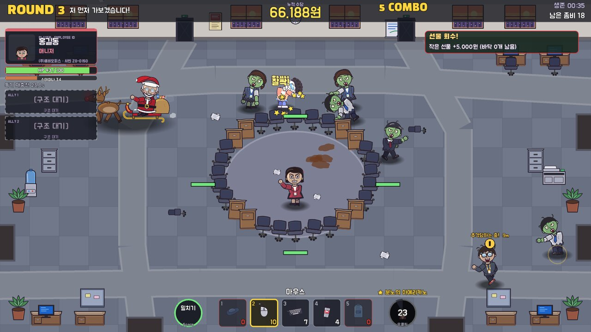
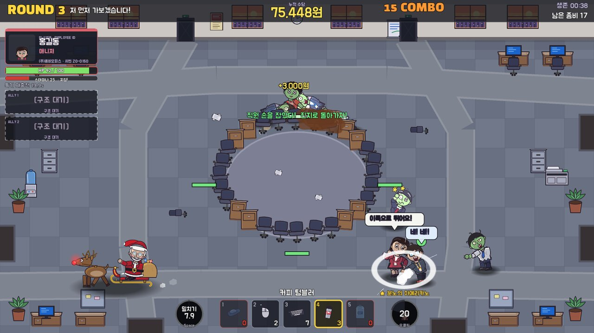
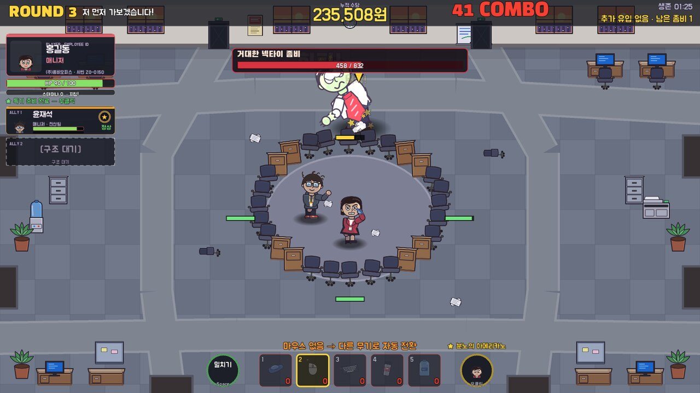
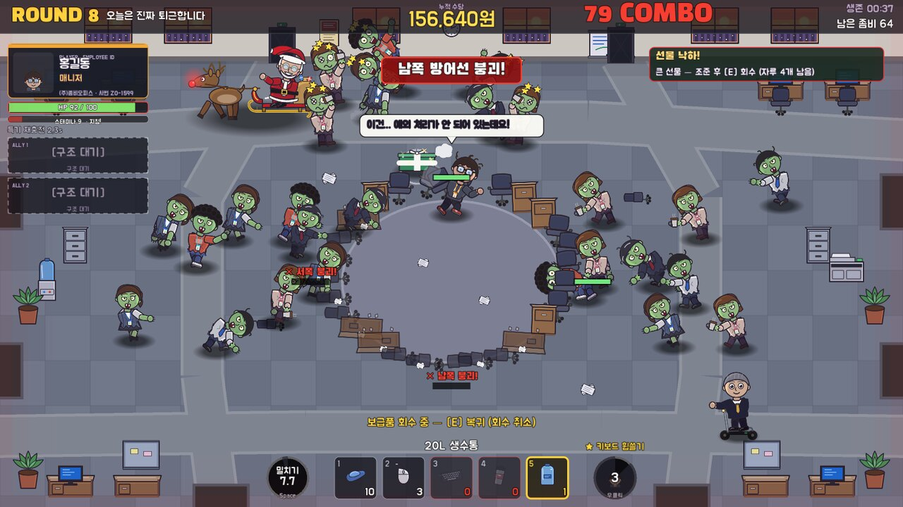

<p align="center"></p>

<h1 align="center">퇴근불가! 좀비 오피스</h1>
<p align="center"><b>ZOMBIE OVERTIME</b> — 사무실 좀비 생존 코믹 아케이드</p>

<p align="center">
  <a href="https://github.com/heartblast/zombie-office-game-releases/releases/download/v1.1.1/ZombieOfficeGame-Windows-v1.1.1.zip"><b>💾 Windows 버전 다운로드 (v1.1.1)</b></a>
</p>

> 금요일 오후 5시 59분. 퇴근까지 딱 1분 남았는데… 사무실에 좀비가 쏟아졌다.
> 책상과 의자로 바리케이드를 치고, 슬리퍼·키보드·모니터·20L 생수통까지 던지며
> **비상 엘리베이터가 복구될 때까지 8라운드를 버텨라.** 오늘도 퇴근은 글렀다.

## 🎮 게임 소개

사무실에 나타난 좀비들에게 맞서 살아남는 코믹 아케이드 생존 게임입니다.

- **사무집기 투척** — 슬리퍼부터 20L 생수통까지, 손에 잡히는 건 전부 무기
- **동료 구조** — 도망치는 직원의 손을 잡고 진지로 데려와 팀을 꾸린다
- **산타·루돌프 이벤트** — 선물 자루를 맞혀 떨어진 선물을 주우면 수당 두둑
- **왕좀비 6종** — 거대한 넥타이, 회전의자, 커피중독… 라운드 끝마다 등장하는 대형 좀비
- **HP 체계** — 한 번 물렸다고 끝나지 않는다. HP 가 0 이 되면 탈진(전투 불능)

| | |
|---|---|
|  |  |
| **산타·루돌프** — 자루를 맞혀 선물 회수 | **동료 구조** — 손을 잡고 진지로 귀환 |
|  |  |
| **왕좀비** — 거대한 넥타이 좀비 등장 | **8라운드** — 사방에서 몰려오는 연말 러시 |

## 💾 다운로드

| 최신 버전 | 배포 일자 | 파일 |
|---|---|---|
| **v1.1.1** | 2026-11-01 | [`ZombieOfficeGame-Windows-v1.1.1.zip`](https://github.com/heartblast/zombie-office-game-releases/releases/download/v1.1.1/ZombieOfficeGame-Windows-v1.1.1.zip) (59.1 MB) |

- 위 파일 이름을 누르면 바로 다운로드됩니다. GitHub 로그인은 필요 없습니다.
- 지난 버전은 [릴리스 목록](https://github.com/heartblast/zombie-office-game-releases/releases)에, 항상 최신 버전은 [Latest 릴리스](https://github.com/heartblast/zombie-office-game-releases/releases/latest)에 있습니다.

## 🕹️ 실행 방법

1. ZIP 파일을 내려받는다
2. 압축을 푼다 (마우스 오른쪽 → **압축 풀기**)
3. `ZombieOfficeGame` 폴더의 **`ZombieOfficeGame.exe`** 를 더블클릭

> **Windows 보호(SmartScreen)** 창이 뜨면 **[추가 정보] → [실행]** 을 누르세요. 코드 서명이 없는 개인 제작 게임이라 처음 실행할 때 나올 수 있습니다.
> 설치 프로그램이 없으니 지울 때는 폴더째 삭제하면 끝.

| 조작 | |
|---|---|
| 마우스 이동 / 좌클릭 | 조준 / 투척 (누르고 있으면 연속) |
| 우클릭 | 캐릭터 특기 |
| 1~5 · 휠 · Tab | 무기 교체 · 인벤토리 |
| E / F | 보급품·선물 회수 / 직원 구조 |
| Space / R | 긴급 밀치기 / 바리케이드 수리 |
| Esc | 일시정지 |

## 📋 게임 정보

- 플랫폼: Windows (64비트 실행 파일)
- 엔진: Godot 4
- 배포 형태: Portable ZIP
- 설치 프로그램: 불필요
- 기록 저장 위치: `%APPDATA%\Godot\app_userdata\퇴근불가! 좀비 오피스\`

<details>
<summary>🔐 파일이 온전한지 확인하기 (선택)</summary>

`ZombieOfficeGame-Windows-v1.1.1.zip` 의 SHA-256:

```
3f3e04b24160c835c8dc5179a3d81359cfb5cb774fa8afdb98c198f94acde611
```

PowerShell 에서 `Get-FileHash .\ZombieOfficeGame-Windows-v1.1.1.zip -Algorithm SHA256` 결과와 같으면 정상입니다. 릴리스마다 `SHA256SUMS.txt` 도 함께 올라갑니다.
</details>

---

이 저장소는 게임 배포 전용입니다. 게임 소스 코드는 포함되어 있지 않습니다.
